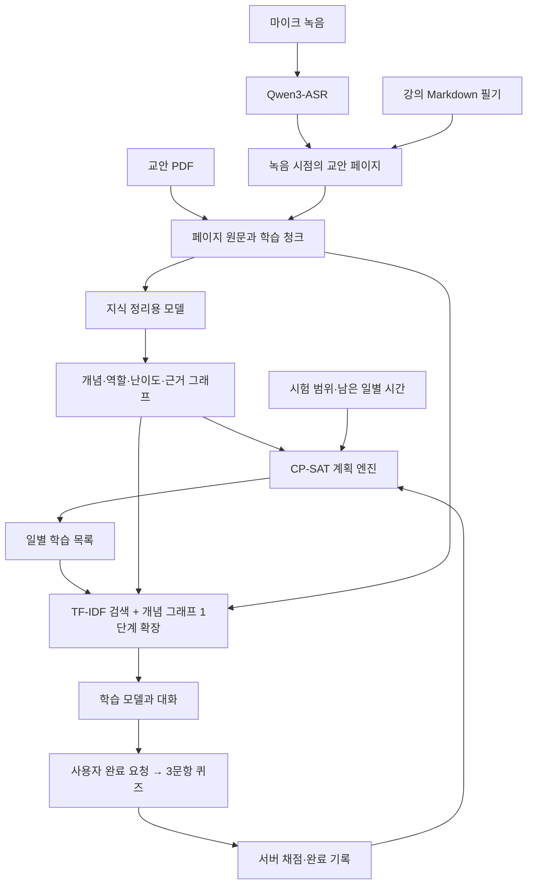

# SPARTADY 제품 아키텍처

## 전체 흐름

Electron의 화면은 제한된 IPC로만 Python 엔진을 호출합니다. Python은 앱에 포함된 독립 실행 파일로 배포되고 별도 HTTP 서버를 열지 않습니다. 원문·청크·그래프·시험·대화·퀴즈·필기는 사용자 데이터 폴더의 SQLite에 저장되며 PDF·WAV·모델은 로컬 파일로 보관합니다. 제품은 빈 저장소로 시작합니다.

## 청크와 지식 그래프

교안 페이지와 텍스트 범위를 원문 기준으로 보존하고 약 450 추정 토큰 단위로 나눕니다. 필기는 강의별 단일 Markdown 문서로 보이지만 내부에서는 문단별로 작성 당시 페이지·시점을 기록합니다. 수정하지 않은 문단은 기존 연결을 유지하고 삭제된 문단은 검색 문맥에서도 제거됩니다. 전사는 페이지 전환 시 녹음을 나누고 구간의 페이지와 연결합니다. 시간은 녹음 구간의 경계이며 단어별 강제 정렬 결과가 아닙니다.

지식 정리용 모델은 각 청크의 가르치는 개념, 전제로 쓰는 개념, 학습 목표, 상대 난이도 및 관계를 추출합니다. 원문에 실제로 있는 인용을 검사하고 변경된 입력만 다시 처리합니다. 단순 페이지 연결은 선수 관계로 간주하지 않습니다. 그래프 원본의 순환은 보존하고 계획용으로 선택한 DAG 투영을 따로 사용합니다. 동일 개념을 가르치는 여러 청크는 대체 학습 자원으로 취급합니다.

## RAG의 실제 구현

1. 청크 제목·개념명·검증된 별칭·교안 및 연결 기록의 본문으로 문자 2~4그램 TF-IDF를 만듭니다.
2. 현재 선택한 개념과 질문에 등장하는 개념을 찾고 typed graph에서 양방향 1단계 이웃을 확장합니다. 거절된 관계는 사용하지 않습니다.
3. 검색 점수에 직접 개념 일치 0.4, 이웃 일치 0.1, 현재 학습 단위 2.0을 더해 순위를 정합니다. 이는 확률이나 선수 강도가 아닙니다.
4. 상위 최대 5개 청크에서 출처 중복을 제거하고, 대화에는 최대 4,800자의 원문 문맥을 제공합니다. 길면 질문 주변 발췌를 사용합니다. 그래프 관계도 해당 근거 인용이 실제 문맥에 있을 때만 전달합니다.
5. 현재 개념·학습 단위·학습 목표·최근 6개 메시지와 검색 결과를 학습 모델에 전달합니다. 답변이 지정한 출처를 검증하고 내부 ID를 교안명·페이지 링크로 바꿉니다.

임베딩 모델이나 벡터 DB를 사용한 구현은 아닙니다. 따라서 한국어 표기 변화와 의미만 비슷한 질문의 검색 품질은 추가 평가 대상입니다.

## 모델 역할

지식 정리용 모델은 설정에서, 대화·퀴즈용 모델은 학습창 상단에서 각각 선택합니다. 로컬 LMX, OpenAI API, 설치된 Codex CLI 로그인 경로를 지원합니다. 설정이 같으면 프로세스를 공유하고 다르면 각각 실행합니다. 학습 모델 변경은 저장된 추출·시험·완료 기록을 변경하지 않습니다. 지식 모델 변경은 사용자가 개념 정리를 다시 실행할 때 새 모델로 추출합니다.

Hugging Face 모델 설치는 저장소 ID를 검증하고 commit을 고정한 뒤 필요한 체크포인트만 다운로드합니다. 자체 Rust importer가 텐서 구조를 확인해 native LMX v2 파일을 쓰고 전체 payload checksum을 검사합니다. 변환 과정에서 원격 Python 코드를 실행하지 않습니다. LOOM의 Apache-2.0 코드 일부를 출처와 함께 제품에 포함했으며 LOOM 서비스나 설치 폴더는 필요하지 않습니다.

## 계획과 완료

계획은 LLM을 호출하지 않습니다. 시간은 20분 슬롯으로 바꾸고 상대 난이도에 따른 비용·시험 목표 가치·선수 제약으로 CP-SAT를 실행합니다. 여러 시험은 가까운 마감부터 처리하는 휴리스틱이며 전체 시험을 동시에 최적화하는 방식은 아닙니다. 시간 감소는 배정 범위 감소로 반영되고 퀴즈 통과는 완료 자원으로 반영됩니다. 필기나 대화만으로 숙달을 추정하지 않습니다.

퀴즈는 현재 학습 단위의 교안 원문에 한정된 객관식 3문항입니다. 선택지 중복·형식·근거 인용을 검사하고 필요하면 동일 모델로 한 번 재생성합니다. 정답은 Python 측에만 저장하고 제출 후 채점합니다. 3/3일 때 완료되며 원문 입력이 달라진 오래된 퀴즈는 거절합니다. 이 검사는 문항의 교육적 타당성을 독립 검증한 결과는 아닙니다.

## 배포

DMG는 Apple Silicon macOS에서, NSIS EXE는 Windows x64에서 각각 빌드합니다. PyInstaller 엔진, 자체 native LMX 실행 파일, uv를 앱 리소스에 포함합니다. 큰 모델과 선택적인 전사 실행 환경은 최초 설치 시 네트워크가 필요하며 이후 로컬에서 실행됩니다. macOS 전사는 MLX, Windows 전사는 공식 Qwen3-ASR의 Transformers/PyTorch 경로를 사용합니다. 서명·공증과 실제 Windows 마이크 장치 검증은 별도 배포 검증 항목입니다.

## 학습 세션과 기존 기록 보존

각 학습 세션은 개념을 포함한 학습 단위·시작 및 갱신 시각·모델 설정·대화·퀴즈 결과를 연결합니다. 학습창은 항상 세션 API에서 메시지를 다시 읽으며 마지막 세션을 이어봅니다. 새 학습 시작은 별도 세션을 만들고 이전 대화는 학습 기록에서 열 수 있습니다. 답변 생성에 실패해도 제출한 질문은 저장됩니다. 이전 버전의 대화는 삭제하지 않고 기존 기록 세션으로 이관합니다. 이전 기록의 실제 시작 시각을 모르는 경우 새 시각을 과거 시작 시각으로 꾸미지 않습니다.

macOS의 한글 파일명은 NFC 키로 통일합니다. 기존 문서 ID·파일 경로·원문·완료 기록을 바꾸지 않고 문서 이름의 비교 키를 보정하므로 교안 선택·시험 범위·원문 링크·페이지에 연결된 기록을 유지합니다.

필기는 Tiptap의 단일 편집 면에서 Markdown 입력 규칙을 적용하고 Markdown으로 직렬화하여 기존 필기·페이지·시간 출처 저장 계층에 전달합니다. 표와 체크리스트를 지원합니다. 대화는 react-markdown/remark-gfm으로 표시하며 원문 링크는 검증된 출처 메타데이터로 별도 제공합니다.

Electron↔Python, Python↔로컬 LMX·전사 엔진의 JSON 통신은 Windows 시스템 언어와 관계없이 UTF-8로 고정합니다. 한글 교안과 필기의 시작·저장 경로를 두 플랫폼의 UI 검사에 포함합니다.
